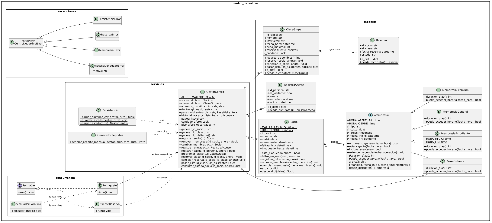

# Documento de Diseño — Centro Deportivo Universitario

## 1. Diagramas UML

### Qué muestra y por qué lo elegimos
Elegimos hacer el **diagrama de clases** porque nos permite ver en una sola imagen cómo dividimos el proyecto en paquetes y cómo se relacionan todas las clases con el código que entregamos:
* En `excepciones` pusimos la jerarquía de errores propios heredando de `CentroDeportivoError`.
* En `modelos` se ve la clase abstracta `Membresia` con sus 4 subclases (`MembresiaEstudiante`, `MembresiaGeneral`, `MembresiaPremium` y `PaseVisitante`), además de cómo un `Socio` tiene su membresía y una `ClaseGrupal` maneja sus objetos `Reserva`.
* En `servicios` aparece `GestorCentro`, que concentra las operaciones del sistema y se apoya en `Persistencia` y `GeneradorReportes`.
* En `concurrencia` se muestra la interfaz `Runnable` que implementan `Torniquete` y `ClienteReserva` para la simulación con hilos.

---

## 2. Decisiones de diseño

| Concepto | Dónde se usa | Qué problema resuelve |
| :--- | :--- | :--- |
| **Encapsulamiento** | `Membresia`, `Socio`, `ClaseGrupal` (`_id_socio`, `_id_clase`, `_tipo`, `_costo`, `@property`) | Evita que se cambien por accidente datos clave como los IDs o los costos de los planes desde fuera de cada clase. |
| **Herencia y clases abstractas** | `Membresia(ABC)` y sus 4 subclases en `modelos/membresia.py`; `Runnable(ABC)` en `concurrencia/runnable.py` | Nos asegura que cualquier tipo de membresía defina su duración y su horario, y separa lo que hace una tarea concurrente de la clase `Thread`. |
| **Composición y agregación** | `Socio` → `Membresia` (composición); `ClaseGrupal` → `Reserva` (composición); `GestorCentro` → `Socio` y `ClaseGrupal` (agregación) | Refleja qué objetos dependen de otros (por ejemplo, una reserva no existe sin su clase) y hace mucho más sencillo guardar y cargar todo en JSON. |
| **Polimorfismo** | `Membresia.crear()`, `puede_acceder_horario()`, `duracion_dias()` | Hace que `GestorCentro` pueda revisar horarios y renovaciones llamando al mismo método sin llenarse de `if/elif` para cada tipo de membresía. |
| **Excepciones** | `excepciones.py` (`CentroDeportivoError`, `AccesoDenegadoError`, `MembresiaError`, `ReservaError`, `PersistenciaError`) | Permite mandar el motivo exacto de cualquier rechazo hasta `main.py` y mostrar un aviso entendible en consola en lugar de que el programa truene con un *traceback*. |
| **Archivos** | `servicios/persistencia.py` y `servicios/reportes.py` (`pathlib.Path`, `csv`, `json`) | Permite leer el CSV de alumnos avisando línea por línea qué renglones están mal, guardar todo el progreso entre ejecuciones en JSON y sacar el reporte mensual en `.txt`. |
| **Hilos** | `threading.Lock` en `GestorCentro` y `ClaseGrupal`; `concurrencia/simulacion.py` (`Thread`, `start()`, `join()`) | Evita que dos torniquetes o dos socios modifiquen el aforo o el cupo al mismo tiempo y los desajusten durante la simulación de hora pico. |
| **Patrones de diseño** | Fachada (`GestorCentro`), Método Fábrica (`Membresia.crear`) e Interfaz `Runnable` | Mantiene el menú de `main.py` simple llamando a un solo gestor, facilita crear membresías a partir de su nombre y deja probar las tareas de simulación con o sin hilos. |

---

## 3. Alternativas que evaluamos

1. **Guardar todo en un solo JSON vs. usar varios archivos CSV:**
   * *La duda:* Al principio pensamos en guardar socios, faltas, clases, reservas y accesos en varios archivos CSV separados, o juntar todo en un único JSON.
   * *Qué elegimos:* Nos fuimos por **JSON** porque en Python ya viene incluido en la biblioteca estándar y guarda muy fácil listas dentro de objetos (como las faltas de cada socio o las reservas de cada clase), sin tener que estar cruzando IDs a mano entre 5 archivos distintos.

2. **Usar una interfaz `Runnable(ABC)` vs. heredar directo de `threading.Thread`:**
   * *La duda:* Podíamos hacer que `Torniquete` y `ClienteReserva` heredaran directamente de `Thread`, o seguir el enfoque de la práctica de hilos usando una clase abstracta `Runnable`.
   * *Qué elegimos:* Elegimos **`Runnable(ABC)`** y pasar `target=tarea.run` a `Thread` porque así la lógica del torniquete y de las reservas queda separada de los hilos, lo que hace más fácil leer el código y probarlo también sin concurrencia si hace falta.

---

## 4. Uso de Inteligencia Artificial
* **Qué le pedimos:** Usamos IA como apoyo para organizar las carpetas del repositorio, revisar detalles finos de las reglas de negocio (como el cálculo de las 48 horas, las 2 horas para cancelar y el bloqueo de 7 días), hacer más amigable el menú de consola (agregando IDs automáticos como `S1`, `C1` y `V1`) y generar el código en PlantUML para nuestro diagrama de clases.
* **Qué usamos y qué corregimos:** Tomamos la división en paquetes (`modelos`, `servicios`, `concurrencia`) y las mejoras del menú en `main.py`. Tuvimos que ajustar rutas, nombres de archivos y el `.gitignore` para que coincidieran con nuestro repositorio `Proyecto-POO`, quitar cualquier cosa que saliera de la biblioteca estándar y agregar archivos JSON extra (`estado_ejemplo.json` y `estado_danado.json`) para poder probar los reportes y errores más rápido.
* **Cómo lo verificamos:** Probamos manualmente cada opción del menú en la terminal con fechas simuladas, revisamos que todos los casos de rechazo imprimieran su motivo sin lanzar *tracebacks*, probamos el JSON dañado y corrimos varias veces la simulación de hora pico para confirmar que el aforo nunca pasara de 60 ni el cupo de la clase se excediera.

---

## 5. Contribuciones del equipo
* **De Anda Moctezuma Ernesto (`feature/excepciones-membresias`):** Creó las excepciones propias en `excepciones.py` y la jerarquía de membresías en `modelos/membresia.py`.
* **Miranda Rodríguez Jesús (`feature/socios-y-clases`):** Desarrolló `Socio`, `Reserva` y `RegistroAcceso` en `modelos/socio.py`, además de `ClaseGrupal` con el control de cupo, faltas y candado en `modelos/clase_grupal.py`.
* **Peña Hernández Luis Noel (`feature/gestor-y-persistencia`):** Implementó `GestorCentro` con el control de aforo en `servicios/gestor_centro.py`, la carga de CSV y persistencia JSON en `servicios/persistencia.py`, y los datos de prueba en `datos/`.
* **Ramírez Arellano Felipe Emanuel (`feature/concurrencia-y-cli`):** Programó el reporte mensual en `servicios/reportes.py`, la simulación con hilos en `concurrencia/` (`runnable.py` y `simulacion.py`) y el menú de terminal en `main.py`.